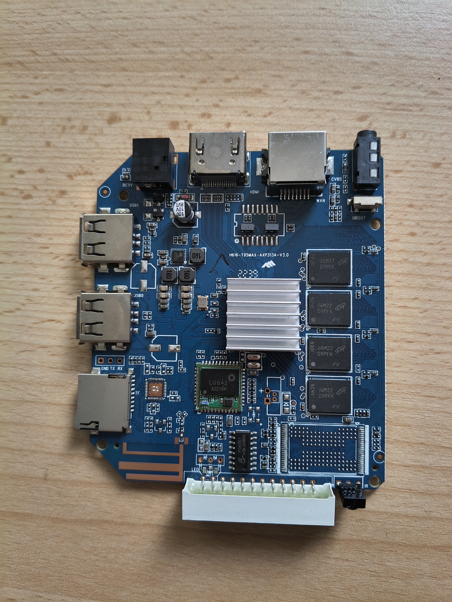
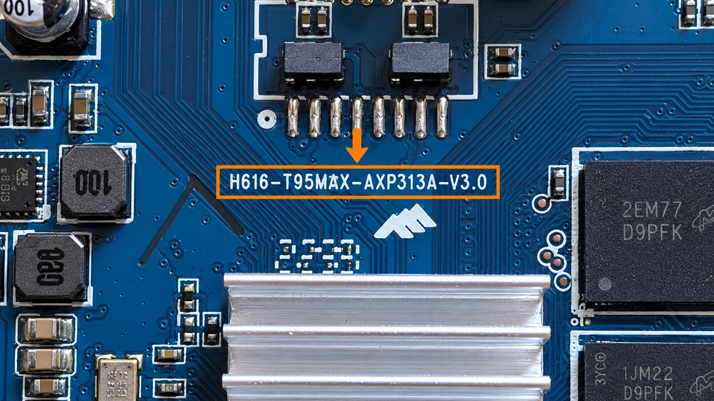
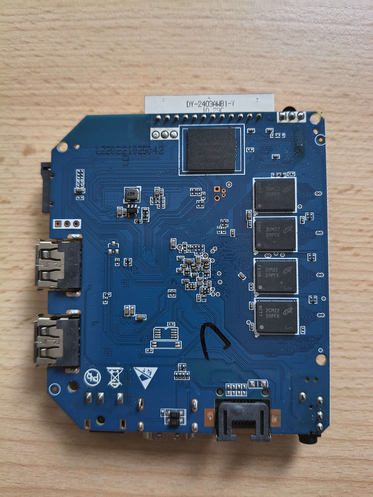
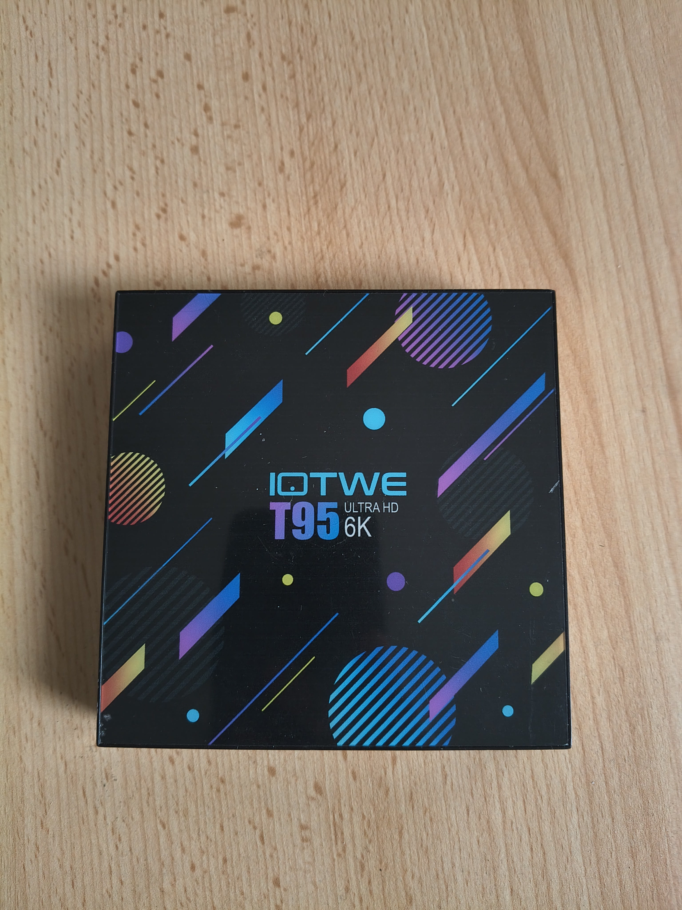
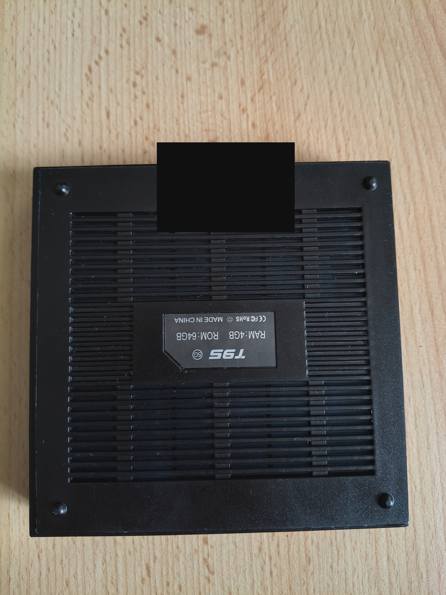

# T95 TV box → Armbian home server

[Deutsch](README.md) | **English**

Turn a T95 with **Allwinner H616 and PCB `H616-T95MAX-AXP313A-V3.0`** into a
small home server. Armbian boots from microSD; Ethernet connects the box to your network.

**[Set up a new box](docs/INSTALLATION.en.md)** · **[Everyday use](docs/DAILY_USE.en.md)** · **[Solve a problem](docs/TROUBLESHOOTING.en.md)**

Armbian is a full Linux system based on Debian 13. Project scripts are
**optional additions for the maintainer's personal use**. Find other applications
in the **[Armbian software catalog](https://docs.armbian.com/software/)** and
[Docker guide](https://docs.armbian.com/software/docker/) — for use **after
base installation, kernel holds, and backup**.


> [!WARNING]
> **Check the PCB first:** [compare its marking with the original photo](#hardware-photos).
> “T95” covers different hardware. Only `H616-T95MAX-AXP313A-V3.0` is tested
> for this image. Stop for a different or unknown board:
> [identify hardware](docs/HARDWARE_IDENTIFICATION.en.md) and use the [developer path](docs/PORTING.en.md).

> [!CAUTION]
> **⛔ REQUIRED: HOLD THE KERNEL AND DTB**
>
> After initial setup, **before installing more software or updating the system**,
> hold the kernel and DTB (hardware description). **Keep these holds enabled
> during normal use.** Replacing them can overwrite T95-specific changes —
> **the box may no longer boot afterward.**
>
> **[→ Required kernel/DTB protection step](docs/INSTALLATION.en.md#5-protect-the-kernel-and-dtb-before-updates)**

## Install the home server

**[→ Begin with installation step 1](docs/INSTALLATION.en.md)**

You need:

- the verified box and its correct power supply;
- an expendable microSD and USB card reader;
- a Linux PC, internet, and Ethernet to the router;
- space for image preparation **plus a separate full-SD backup**.

The guide explains Terminal and SSH, the remote connection to your box.
Windows/WSL2 has a separate section with additional device requirements.

**Hardware → PC → SD → SSH → hold kernel → backup → optional file server**

> [!IMPORTANT]
> **No default password:** create a personal image copy with your own password
> before writing. The installer guides you through it.
> **Writing erases the entire selected SD.** Internal Android storage (eMMC)
> is not written by this route.

## Hardware photos

Disconnect all power before opening the box. **Look for `H616-T95MAX-AXP313A-V3.0`**
on the connector side above the heatsink. Compare it with your PCB;
the case name alone is insufficient.

<p>
  <a href="docs/images/t95-board-connectors.jpg"></a>
  <a href="docs/images/t95-board-identification.png"></a>
</p>

**Click either image to enlarge it.** The AI-assisted detail highlights the PCB
marking. Use the unchanged original photo as the reference for hardware inspection.

<details>
<summary>Show more hardware photos</summary>

<p>
  <a href="docs/images/t95-board-memory.jpg"></a>
  <a href="docs/images/t95-box-top.jpg"></a>
  <a href="docs/images/t95-case-bottom-redacted.jpg"></a>
</p>

Click to enlarge originals. EXIF/GPS data was removed and individual stickers are covered.

</details>

## What works?

| Function | Status |
| --- | --- |
| microSD boot, Ethernet, SSH, shutdown | ✅ Tested |
| Samba, USB drives, VLC over SMB | ✅ Tested; optional setup |
| SSH dashboard and Bluetooth music player | ✅ Tested; optional setup |
| eMMC as a data drive | ✅ Tested; separate preparation |
| Armbian boot from eMMC | Unsupported; use microSD |
| Wi-Fi, HDMI as a server function, infrared remote | Not tested |

Reference: **Armbian 26.8.4 / Debian 13 / kernel `6.18.48-current-sunxi64`**.
The maintainer confirmed the dashboard/Bluetooth steps work on **2026-10-17**.
[Test evidence](docs/VALIDATION.en.md) tracks further acceptance and long-term tests.
Ethernet: 100 Mbit/s, measured at about 11–12 MB/s.

## Daily use

**[→ Open everyday use](docs/DAILY_USE.en.md)** for reconnecting, file access,
safe USB ejection, Bluetooth, music, rebooting, and shutting down.
Use [troubleshooting by symptom](docs/TROUBLESHOOTING.en.md) for errors.

## Optional extensions

After base installation, kernel holds, and a private SD backup:

| Your goal | Guide |
| --- | --- |
| Share files and use USB drives | [Set up file sharing](server/samba-usb/README.en.md) |
| See system information at SSH login | [Dashboard](docs/SSH_DASHBOARD.en.md) |
| Send music to headphones or speakers | [Bluetooth music player](server/bluetooth/README.en.md) |
| Set up dashboard and player through a menu | [Shared setup](server/setup/README.en.md) |
| Use internal eMMC for data | [Requirements for experienced users](docs/TECHNICAL_REFERENCE.en.md#emmc-as-an-internal-data-drive) |

**File sharing tailored to the TV box's USB ports:** the Samba module uses
regular Samba packages with a custom project configuration and USB helpers.
Once set up, USB sticks, SSDs, external hard drives, and other USB storage
with supported filesystems are **mounted automatically and made available
as separate SMB network shares**. You do not need to mount them manually or
create individual shares during everyday use.
[Eject the drive safely](server/samba-usb/README.en.md#safely-eject-usb-storage) before unplugging it.

**Dashboard with extra storage information:** the script-installed SSH dashboard
adds the **amount written to the SD card since the last boot** and an **overview
of mounted drives, including USB storage**, to Armbian's login display.
Device names, total capacity, free space, usage, and mount paths appear directly
at SSH login. The [dashboard guide](docs/SSH_DASHBOARD.en.md) explains these readings.

## Install other applications

Choose **ARM64-compatible** applications that fit the box's CPU,
**2 GiB RAM**, and free storage. Leave capacity for Armbian and existing services;
project modules are optional.

> [!CAUTION]
> **Keep kernel/DTB holds enabled.** Do not enable kernel switching or
> kernel/firmware/bootloader updates in `armbian-config`. Normal application
> packages can be updated with the holds in place.

**On the T95, normal SSH user with `sudo`:**

```bash
sudo armbian-config
```

In [Armbian configuration](https://docs.armbian.com/config/), select **Software**,
then a category and application. Docker is under **Software → Containers → Docker**.
See requirements and instructions in the [software catalog](https://docs.armbian.com/software/).

<details>
<summary>Source versions and developer details</summary>

## Source versions

| Component | Source |
| --- | --- |
| Base image | [Release `v1.0.1`](https://github.com/Web-Developer-DB/t95-tvbox-to-armbian-home-server/releases/tag/v1.0.1) |
| SD preparation launcher | `main`; explicitly obtains image tools from tag `v1.0.1` |
| Documentation and optional server modules | `main` |
| Local server-module checkout on the T95 | `main`; see [setup guide](server/setup/README.en.md#local-checkout) |

The base image is a release asset. A Git checkout contains tools and docs.
The PC's release-tools folder is not a checkout of the current server modules.
Each guide owns its installation commands; do not mix files from different
source versions.

## Documentation and developer path

| Task | Start here |
| --- | --- |
| Set up a new box | [Installation](docs/INSTALLATION.en.md) |
| Resolve a visible error | [Troubleshooting](docs/TROUBLESHOOTING.en.md) |
| Back up or restore the system | [SD backup](docs/BACKUP.en.md) |
| Understand hardware and changes | [Technical reference](docs/TECHNICAL_REFERENCE.en.md), [Armbian changes](docs/CHANGES_FROM_ARMBIAN.en.md) |
| Inspect release layout or deliberate kernel updates | [Release handbook](docs/RELEASE.en.md) |
| Investigate another H616 board | [Porting](docs/PORTING.en.md), [UART](docs/UART_BRINGUP.en.md), [boot diagnostics](docs/BOOT_TROUBLESHOOTING.en.md) |
| Build or publish an image | [Build chain](build/README.en.md), [publishing](docs/PUBLISHING.en.md), [release text](docs/GITHUB_RELEASE_NOTES.en.md) |

UART is the diagnostic path for porting and early boot failures. Prepare a
**3.3 V TTL adapter** before those tasks; never connect 5 V TTL or RS-232.
Hardware details and wiring belong to the developer path.

</details>

## Project and boundaries

This private project began with an Android installation classified or
suspected as BadBox-affected. The SD conversion does not use Android as its
operating system or trust source. It does not automatically clean or remove
Android eMMC.

Keep personal images, backups, credentials, and raw diagnostic captures
private. An SD backup excludes separate USB/eMMC data. A full base-installation
run on a separate SD is tracked in the
[acceptance checklist](docs/VALIDATION.en.md#installation-guide-acceptance).
The confirmed dashboard/Bluetooth steps are documented separately there.

## License

No repository license has been selected yet. Before redistribution, review
the project license and adopted upstream licenses. Existing Armbian license
notices remain in place.

<details>
<summary>Earlier section links</summary>

<a id="uart-before-porting"></a><a id="uart-diagnostics-with-rp2040-zero"></a><a id="developer-build-and-porting"></a>

[Porting / UART](docs/PORTING.en.md)

<a id="end-user-quick-start"></a><a id="one-script-installation"></a><a id="required-after-the-first-ssh-login-hold-the-kernel-and-dtb"></a><a id="manual-installation"></a>

[Installation](docs/INSTALLATION.en.md)

<a id="optional-next-step-samba-file-server-and-usb-automount"></a><a id="samba-and-usb-file-server"></a>

[Samba / USB](server/samba-usb/README.en.md)

<a id="requirements"></a>

[Developer reference](build/README.en.md)

<a id="armbian-baseline-and-t95-changes"></a><a id="verified-status"></a><a id="emmc-as-an-internal-data-drive"></a>

[Technical reference](docs/TECHNICAL_REFERENCE.en.md)

<a id="security-backups-and-updates"></a>

[Backup](docs/BACKUP.en.md)

</details>
