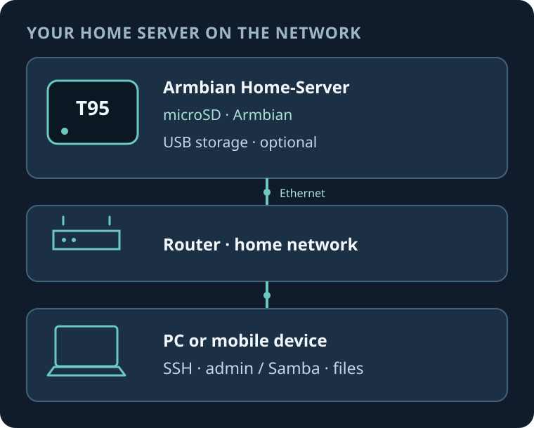
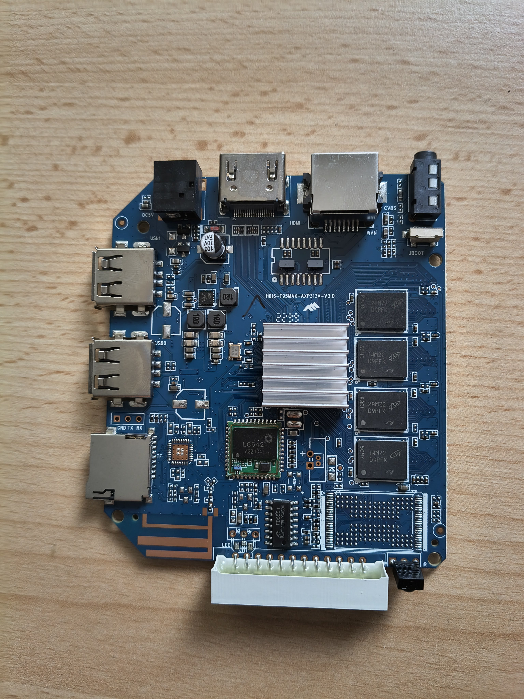
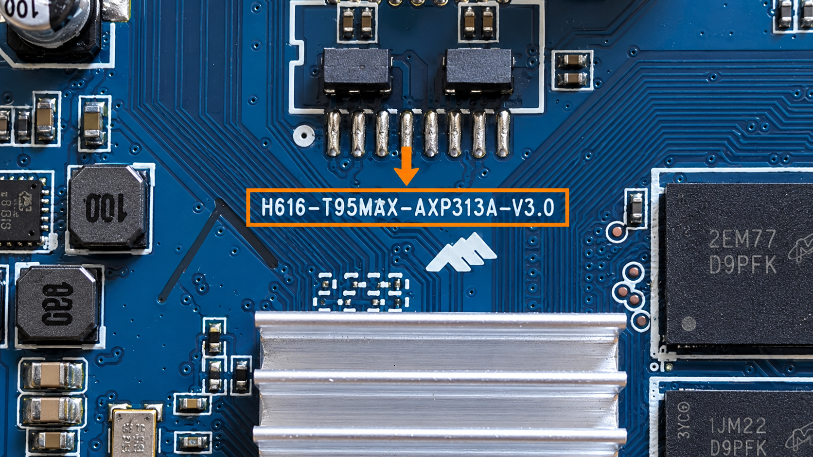
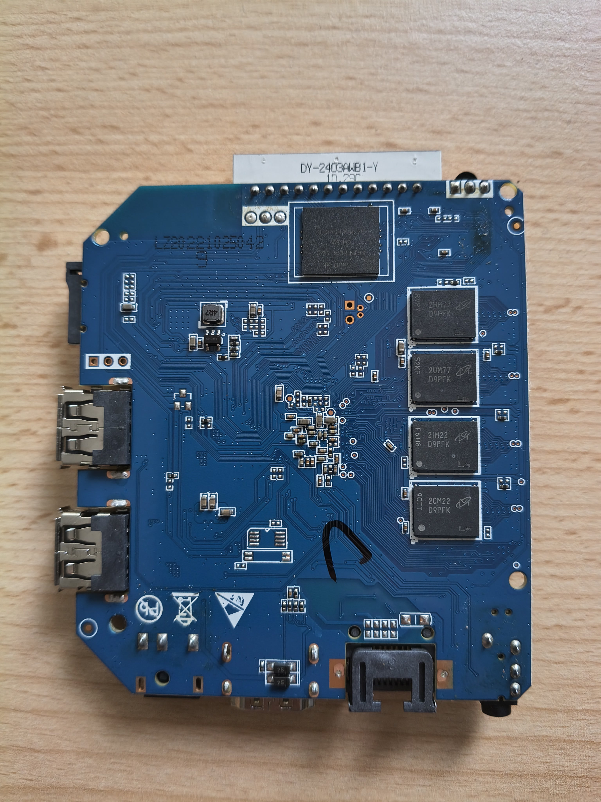
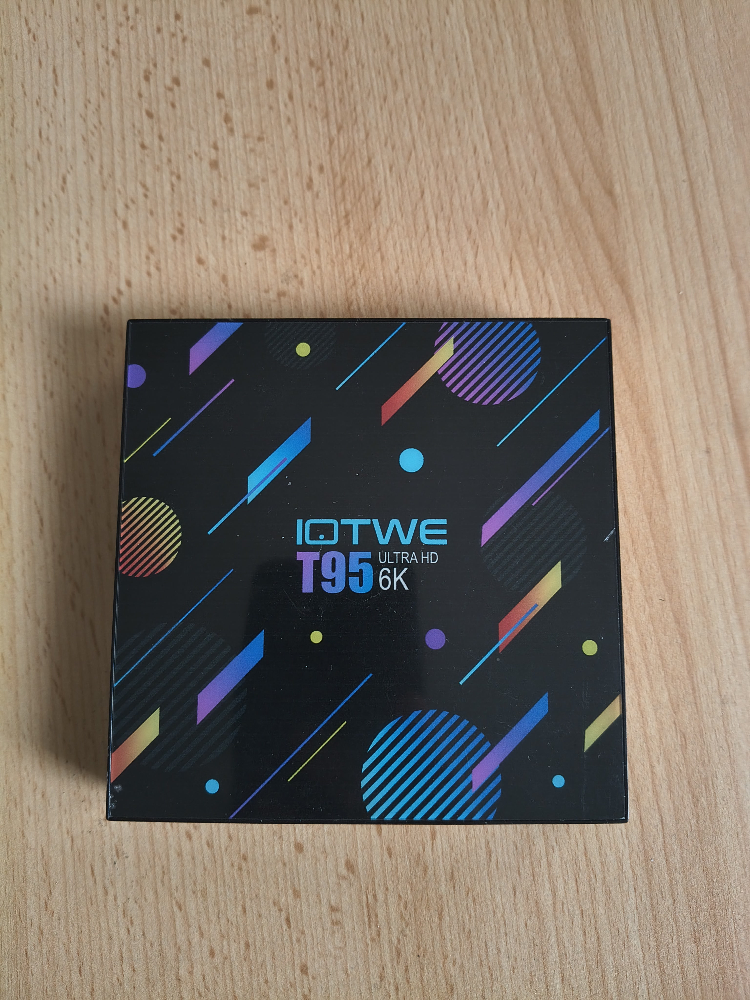
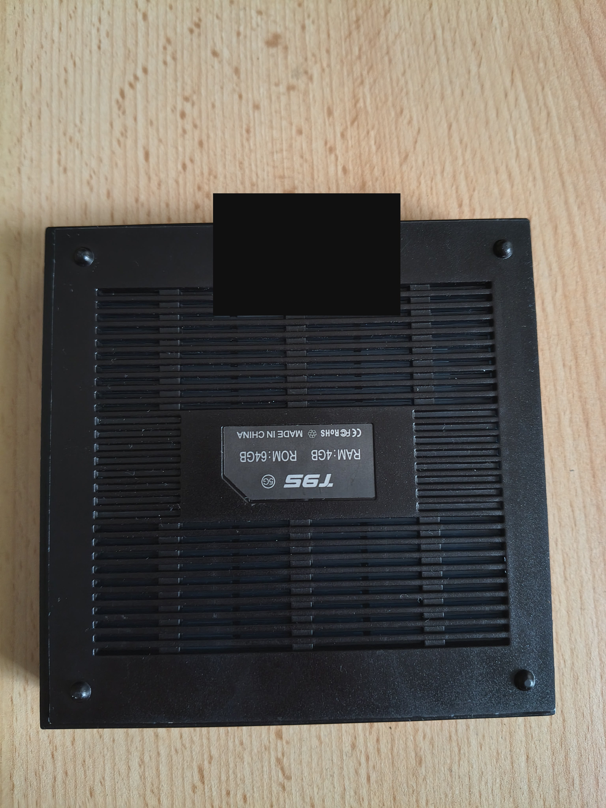
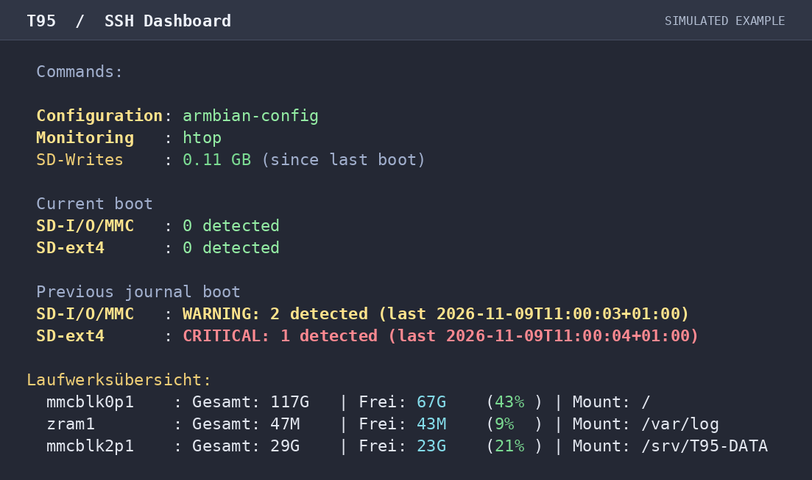

# T95 TV box → Armbian home server

**[Deutsch](README.md)** | English

Turn the verified T95 TV box into a small home server. Armbian boots from a
microSD card and connects the box to your home network using Ethernet. From a
PC, manage the server over SSH (remote access) and share files using Samba.

**[🚀 Start installation](docs/INSTALLATION.en.md)** · **[🧭 Daily use](docs/DAILY_USE.en.md)** · **[🛟 Get help](docs/TROUBLESHOOTING.en.md)**

## 🧩 What can the home server do?

Set up these extensions after the base installation and kernel hold.

| Feature | What you can do | Guide |
| --- | --- | --- |
| 📂 File server | Share supported USB drives on your network and eject them safely | [Samba and USB](server/samba-usb/README.en.md) |
| 📊 SSH dashboard | See disk space, SD writes and logged SD errors at login | [Dashboard](docs/SSH_DASHBOARD.en.md) |
| 🎧 Bluetooth music player | Play music through connected headphones or a speaker | [Bluetooth player](server/bluetooth/README.en.md) |

Find more applications with ARM64 support in the [Armbian software catalogue](https://docs.armbian.com/software/).

## 📷 Hardware photos

Disconnect all power before opening the box. **Look for `H616-T95MAX-AXP313A-V3.0`**
on the connector side above the heatsink. Compare it with your PCB;
the case name alone is insufficient.

  
  

**Click either image to enlarge it.** The AI-assisted detail highlights the PCB
marking. Use the unchanged original photo as the reference for hardware inspection.

📷 Show more hardware photos

  
  
  

Click to enlarge originals. EXIF/GPS data was removed and individual stickers are covered.

> [!WARNING]
> **Only the `H616-T95MAX-AXP313A-V3.0` board is verified for this image.**
> For a different or unidentified board, stop here and use the
> [hardware identification guide](docs/HARDWARE_IDENTIFICATION.en.md) and [developer path](docs/PORTING.en.md).

## 🚀 Set up the server

**Check the board → prepare a personal microSD → start the box → connect over SSH → protect the kernel and DTB**

You need a verified T95 with its power supply, an expendable microSD, a USB card
reader, an Ethernet cable, and a Linux PC with internet and at least 6 GB free.
The guide also describes the extra requirements for Windows with WSL2. A full
SD backup needs additional space.

> [!IMPORTANT]
> Create a personal image copy with your own password before writing.
> **The selected SD medium is erased completely.** The internal eMMC storage
> in the box is not written during this step.

> [!CAUTION]
> **Hold the kernel and DTB after initial setup.** The DTB describes the hardware
> to the kernel. Apply the holds before updates or further software installation
> and keep them during normal use. Replacing these components can prevent the
> adapted box from booting. [Protect the kernel and DTB](docs/INSTALLATION.en.md#5-protect-the-kernel-and-dtb-before-updates)

**[→ Open the complete installation guide](docs/INSTALLATION.en.md)**

## ✅ What works?

| Feature | Status |
| --- | --- |
| microSD boot, Ethernet, SSH and shutdown | ✅ Tested |
| Samba, USB drives and VLC over SMB | ✅ Tested; optional setup |
| SSH dashboard and Bluetooth music player | ✅ Tested; optional setup |
| eMMC as data storage | ✅ Tested; separate preparation |
| Armbian boot from eMMC | 🚫 Unsupported; use microSD |
| Wi-Fi, HDMI as a server function, infrared | ❔ Not tested |

For the new USB management, Samba reading and writing, ejection and reinsertion
of an exFAT drive were confirmed on the T95. Other filesystems and multiple
simultaneous drives still need testing. [Validation](docs/SAMBA_USB_AUDIT.en.md)

Reference system: Armbian 26.8.4, Debian 13 and kernel `6.18.48-current-sunxi64`.
Ethernet runs at 100 Mbit/s, measured at about 11–12 MB/s. [Test evidence](docs/VALIDATION.en.md)

## 📊 The SSH dashboard

At each new login the dashboard shows SD write load and logged SD errors among
other information. Colors make the status easy to see.

*Example with simulated journal messages and drive figures. Click to enlarge.*
[Set up the dashboard](docs/SSH_DASHBOARD.en.md)

## 🧭 Guides and help

| Your goal | Start here |
| --- | --- |
| 🚀 Set up a compatible T95 | [Installation](docs/INSTALLATION.en.md) |
| 📂 Open files and operate the server | [Daily use](docs/DAILY_USE.en.md) |
| 🔌 Share and safely eject USB drives | [Samba and USB](server/samba-usb/README.en.md) |
| 🎧 Listen to music over Bluetooth | [Bluetooth player](server/bluetooth/README.en.md) |
| 🗂️ Back up or restore the system | [SD backup](docs/BACKUP.en.md) |
| 🛟 Resolve a problem | [Troubleshooting](docs/TROUBLESHOOTING.en.md) |
| 🧩 Set up dashboard and Bluetooth together | [Shared setup](server/setup/README.en.md) |
| 💾 Prepare internal eMMC for data | [Technical reference](docs/TECHNICAL_REFERENCE.en.md#emmc-as-an-internal-data-drive) |

After base setup, choose further applications using `armbian-config`. Keep the
kernel and DTB holds in place. [Armbian configuration](https://docs.armbian.com/config/)

🛠️ Source versions and developer details

## 🛠️ Source versions

| Component | Source |
| --- | --- |
| Base image | [Release `v1.0.1`](https://github.com/Web-Developer-DB/t95-tvbox-to-armbian-home-server/releases/tag/v1.0.1) |
| SD preparation launcher | `main`; explicitly obtains image tools from tag `v1.0.1` |
| Documentation and optional server modules | `main` |
| Local server-module checkout on the T95 | `main`; see [setup guide](server/setup/README.en.md#local-checkout) |

The base image is a release asset. A Git checkout contains tools and docs.
The PC's release-tools folder is not a checkout of the current server modules.
Each guide owns its installation commands; do not mix files from different
source versions.

## 📚 Documentation and developer path

| Task | Start here |
| --- | --- |
| Set up a new box | [Installation](docs/INSTALLATION.en.md) |
| Resolve a visible error | [Troubleshooting](docs/TROUBLESHOOTING.en.md) |
| Back up or restore the system | [SD backup](docs/BACKUP.en.md) |
| Understand hardware and changes | [Technical reference](docs/TECHNICAL_REFERENCE.en.md), [Armbian changes](docs/CHANGES_FROM_ARMBIAN.en.md) |
| Inspect release layout or deliberate kernel updates | [Release handbook](docs/RELEASE.en.md) |
| Investigate another H616 board | [Porting](docs/PORTING.en.md), [UART](docs/UART_BRINGUP.en.md), [boot diagnostics](docs/BOOT_TROUBLESHOOTING.en.md) |
| Build or publish an image | [Build chain](build/README.en.md), [publishing](docs/PUBLISHING.en.md), [release text](docs/GITHUB_RELEASE_NOTES.en.md) |

UART is the diagnostic path for porting and early boot failures. Prepare a
**3.3 V TTL adapter** before those tasks; never connect 5 V TTL or RS-232.
Hardware details and wiring belong to the developer path.

## ℹ️ Project and boundaries

This private project began with an Android installation classified or
suspected as BadBox-affected. The SD conversion does not use Android as its
operating system or trust source. It does not automatically clean or remove
Android eMMC.

Keep personal images, backups, credentials, and raw diagnostic captures
private. An SD backup excludes separate USB/eMMC data. A full base-installation
run on a separate SD is tracked in the
[acceptance checklist](docs/VALIDATION.en.md#installation-guide-acceptance).
The confirmed dashboard/Bluetooth steps are documented separately there.

## 📄 License

No repository license has been selected yet. Before redistribution, review
the project license and adopted upstream licenses. Existing Armbian license
notices remain in place.

🔗 Earlier section links

[Porting / UART](docs/PORTING.en.md)

[Installation](docs/INSTALLATION.en.md)

[Samba / USB](server/samba-usb/README.en.md)

[Developer reference](build/README.en.md)

[Technical reference](docs/TECHNICAL_REFERENCE.en.md)

[Backup](docs/BACKUP.en.md)

