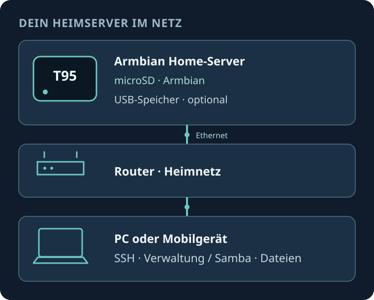
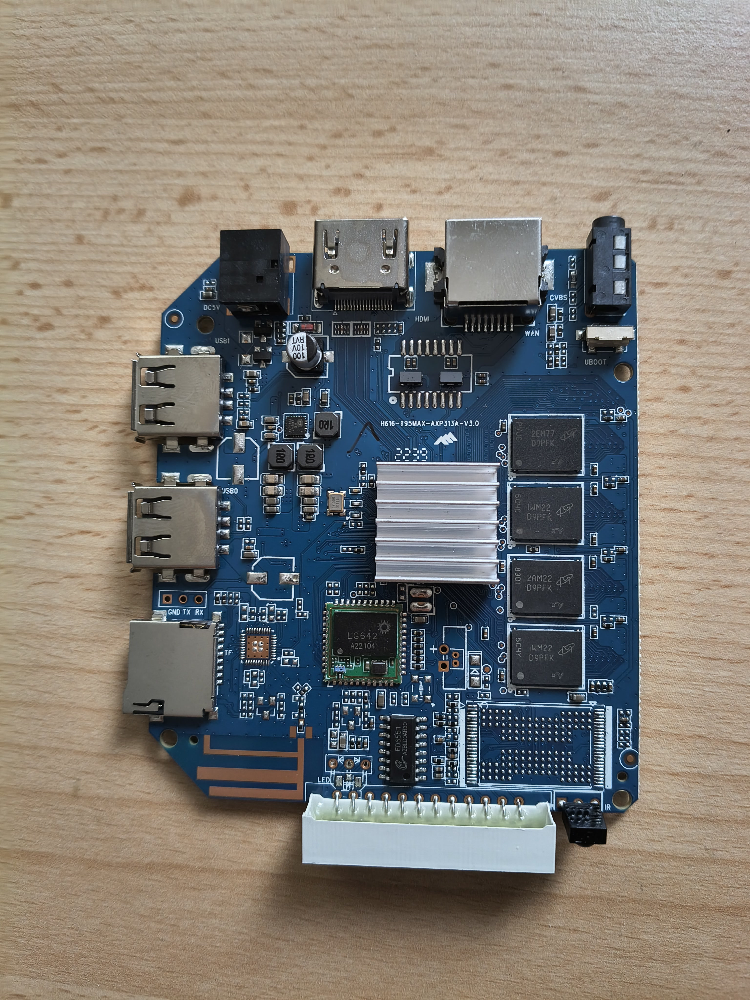
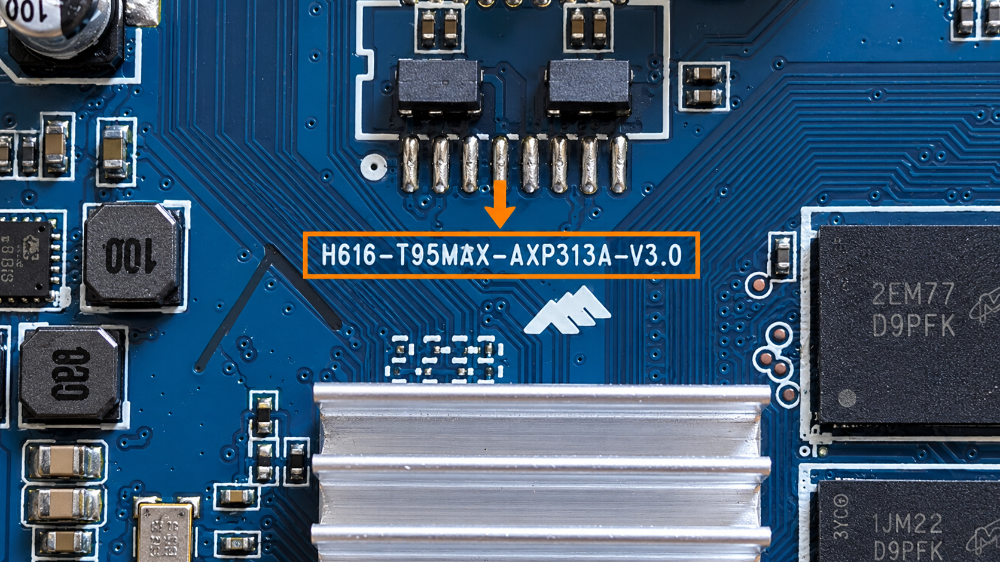
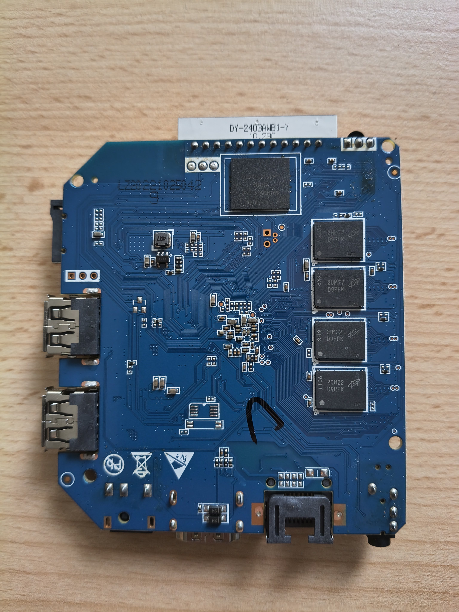
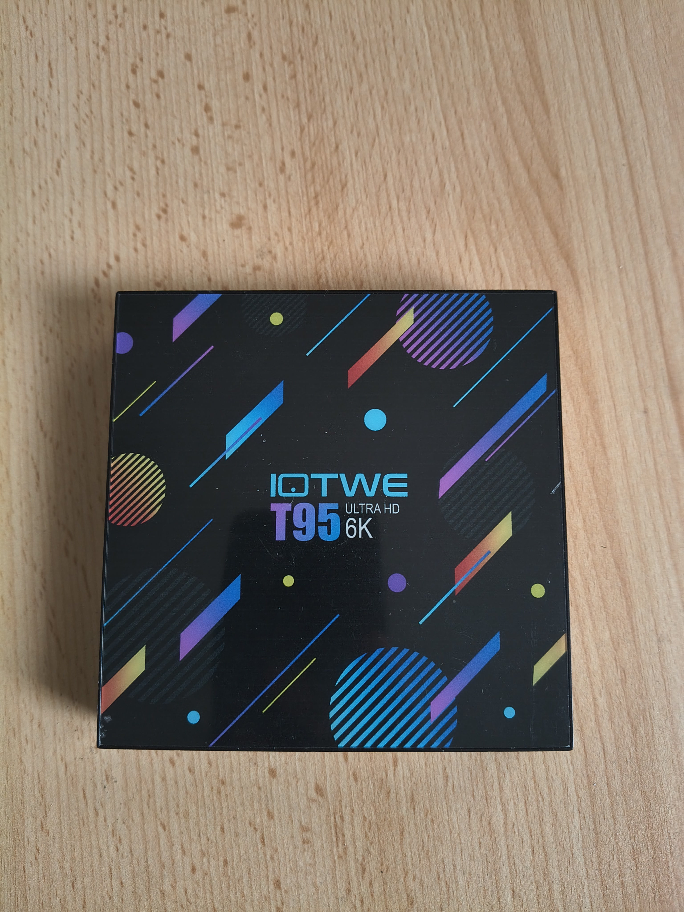
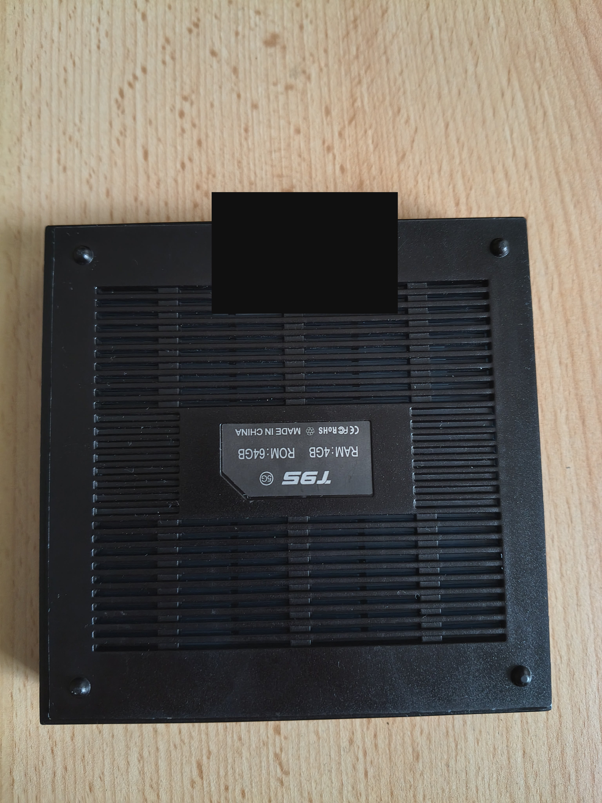
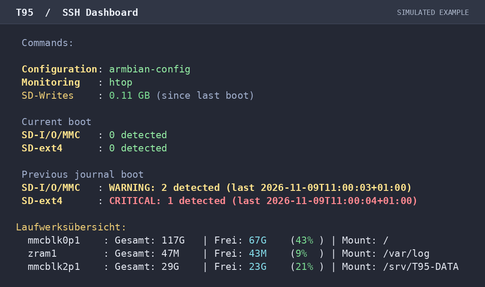

# T95 TV-Box → Armbian Home-Server

**Deutsch** | [English](README.en.md)

Verwandle die geprüfte T95-TV-Box in einen kleinen Heimserver. Armbian startet
von einer microSD-Karte und verbindet die Box über ein Ethernet-Kabel mit deinem
Heimnetz. Vom PC aus verwaltest du den Server per SSH (Fernzugriff) und kannst
Dateien über Samba im Netzwerk bereitstellen.

**[🚀 Installation starten](docs/INSTALLATION.md)** · **[🧭 Alltag](docs/DAILY_USE.md)** · **[🛟 Hilfe](docs/TROUBLESHOOTING.md)**

## 🧩 Was kann der Heimserver?

Diese Erweiterungen richtest du nach der Grundinstallation und der Kernel-Sperre ein.

| Funktion | Was du damit machst | Anleitung |
| --- | --- | --- |
| 📂 Dateiserver | Unterstützte USB-Laufwerke im Heimnetz freigeben und sicher auswerfen | [Samba und USB](server/samba-usb/README.md) |
| 📊 SSH-Dashboard | Bei der Anmeldung Speicherplatz, SD-Schreiblast und protokollierte SD-Fehler sehen | [Dashboard](docs/SSH_DASHBOARD.md) |
| 🎧 Bluetooth-Musikplayer | Musik über einen verbundenen Kopfhörer oder Lautsprecher abspielen | [Bluetooth-Musikplayer](server/bluetooth/README.md) |

Weitere Anwendungen mit ARM64-Unterstützung findest du im [Armbian-Software-Katalog](https://docs.armbian.com/software/).

## 📷 Hardware-Fotos

Box vor dem Öffnen vollständig von der Stromversorgung trennen.
**Gesuchter Aufdruck: `H616-T95MAX-AXP313A-V3.0`**, auf der Anschlussseite
oberhalb des Kühlkörpers. Vergleiche ihn mit deiner Platine; der Gehäusename genügt nicht.

  
  

**Bilder anklicken und vergrößern.** Die KI-unterstützte Detailansicht markiert
den Platinenaufdruck. Für den Hardwareabgleich ist das unveränderte Originalfoto maßgeblich.

📷 Weitere Hardwarefotos anzeigen

  
  
  

Die Originalfotos lassen sich vergrößern. EXIF-/GPS-Daten sind entfernt;
individuelle Aufkleber sind abgedeckt.

> [!WARNING]
> **Nur die Platine `H616-T95MAX-AXP313A-V3.0` ist für dieses Image geprüft.**
> Bei anderer oder unbekannter Platine halte hier an und nutze die
> [Hardwareidentifikation](docs/HARDWARE_IDENTIFICATION.md) und den [Entwicklerpfad](docs/PORTING.md).

## 🚀 So richtest du den Server ein

**Platine prüfen → persönliche microSD vorbereiten → Box starten → per SSH verbinden → Kernel und DTB schützen**

Du benötigst eine passende T95 mit Netzteil, eine entbehrliche microSD, einen
USB-Kartenleser, ein Ethernet-Kabel und einen Linux-PC mit Internet und mindestens
6 GB freiem Speicher. Die Anleitung beschreibt auch die zusätzlichen Bedingungen
für Windows mit WSL2. Ein vollständiges SD-Backup benötigt zusätzlichen Platz.

> [!IMPORTANT]
> Vor dem Schreiben erzeugst du eine persönliche Image-Kopie mit eigenem Passwort.
> **Das ausgewählte SD-Medium wird vollständig gelöscht.** Der interne eMMC-Speicher
> der Box wird dabei nicht beschrieben.

> [!CAUTION]
> **Kernel und DTB nach der Ersteinrichtung sperren.** Das DTB beschreibt die
> Hardware für den Kernel. Die Sperre vor Updates und weiterer Softwareinstallation
> setzen und im normalen Betrieb beibehalten. Ein Austausch kann verhindern,
> dass die angepasste Box startet. [Kernel und DTB schützen](docs/INSTALLATION.md#5-kernel-und-dtb-vor-updates-schützen)

**[→ Zur vollständigen Installationsanleitung](docs/INSTALLATION.md)**

## ✅ Was funktioniert?

| Funktion | Stand |
| --- | --- |
| microSD-Boot, Ethernet, SSH und Herunterfahren | ✅ Getestet |
| Samba, USB-Laufwerke und VLC über SMB | ✅ Getestet; optionale Einrichtung |
| SSH-Dashboard und Bluetooth-Musikplayer | ✅ Getestet; optionale Einrichtung |
| eMMC als Datenlaufwerk | ✅ Getestet; eigene Vorbereitung nötig |
| Armbian von eMMC starten | 🚫 Nicht unterstützt; microSD verwenden |
| WLAN, HDMI als Serverfunktion, Infrarot | ❔ Nicht geprüft |

Für die neue USB-Verwaltung sind Lesen und Schreiben über Samba, Auswerfen und
Wiedereinstecken eines exFAT-Sticks auf der T95 bestätigt. Weitere Dateisystem-
und Mehrgerätetests sind offen. [Prüfstand](docs/SAMBA_USB_AUDIT.md)

Referenzsystem: Armbian 26.8.4, Debian 13 und Kernel `6.18.48-current-sunxi64`.
Ethernet erreicht 100 Mbit/s, gemessen etwa 11–12 MB/s. [Testnachweise](docs/VALIDATION.md)

## 📊 Einblick in das SSH-Dashboard

Das Dashboard zeigt bei jeder neuen Anmeldung unter anderem Schreiblast und
protokollierte Fehler der SD-Karte. Die Farben machen den Status erkennbar.

*Beispielansicht mit simulierten Journalmeldungen und Laufwerkswerten. Zum Vergrößern anklicken.*
[Dashboard einrichten](docs/SSH_DASHBOARD.md)

## 🧭 Anleitungen und Hilfe

| Dein Ziel | Hier geht es weiter |
| --- | --- |
| 🚀 Eine passende T95 einrichten | [Installation](docs/INSTALLATION.md) |
| 📂 Dateien öffnen und den Server bedienen | [Alltag](docs/DAILY_USE.md) |
| 🔌 USB-Laufwerke teilen und sicher auswerfen | [Samba und USB](server/samba-usb/README.md) |
| 🎧 Musik über Bluetooth hören | [Bluetooth-Musikplayer](server/bluetooth/README.md) |
| 🗂️ Das System sichern oder wiederherstellen | [SD-Backup](docs/BACKUP.md) |
| 🛟 Ein Problem lösen | [Hilfe nach Symptomen](docs/TROUBLESHOOTING.md) |
| 🧩 Dashboard und Bluetooth gemeinsam einrichten | [Gemeinsame Einrichtung](server/setup/README.md) |
| 💾 Interne eMMC für Daten vorbereiten | [Technische Referenz](docs/TECHNICAL_REFERENCE.md#emmc-als-internes-datenlaufwerk) |

Weitere Anwendungen kannst du nach der Grundinstallation über `armbian-config`
auswählen. Die Kernel-/DTB-Sperre bleibt dabei gesetzt.
[Armbian-Konfiguration](https://docs.armbian.com/config/)

🛠️ Quellstände und Entwicklerdetails

## 🛠️ Quellstände

| Bestandteil | Verwendeter Stand |
| --- | --- |
| Basisimage | [Release `v1.0.1`](https://github.com/Web-Developer-DB/t95-tvbox-to-armbian-home-server/releases/tag/v1.0.1) |
| Startskript für die SD-Vorbereitung | `main`; lädt die Image-Werkzeuge ausdrücklich vom Tag `v1.0.1` |
| Dokumentation und optionale Servermodule | `main` |
| Lokaler Checkout für Servermodule auf der T95 | `main`; siehe [Setup-Anleitung](server/setup/README.md#lokaler-checkout) |

Das Basisimage wird als Release-Asset geladen. Ein Git-Checkout enthält
Skripte und Dokumentation. Der Release-Werkzeugeordner auf dem PC ist kein
Checkout der aktuellen Servermodule. Installationsbefehle stehen jeweils in ihrer
zuständigen Anleitung; Dateien verschiedener Quellstände nicht mischen.

## 📚 Dokumentation und Entwicklerpfad

| Aufgabe | Einstieg |
| --- | --- |
| Neue Box einrichten | [Installation](docs/INSTALLATION.md) |
| Probleme anhand einer Fehlermeldung lösen | [Hilfe nach Symptomen](docs/TROUBLESHOOTING.md) |
| System sichern oder wiederherstellen | [SD-Backup](docs/BACKUP.md) |
| Hardwarestand und Änderungen verstehen | [Technische Referenz](docs/TECHNICAL_REFERENCE.md), [Armbian-Änderungen](docs/CHANGES_FROM_ARMBIAN.md) |
| Release, Layout und bewusstes Kernelupdate prüfen | [Release-Handbuch](docs/RELEASE.md) |
| Andere H616-Platine untersuchen | [Portierung](docs/PORTING.md), [UART](docs/UART_BRINGUP.md), [Bootdiagnose](docs/BOOT_TROUBLESHOOTING.md) |
| Image bauen oder veröffentlichen | [Buildkette](build/README.md), [Veröffentlichung](docs/PUBLISHING.md), [Release-Text](docs/GITHUB_RELEASE_NOTES.md) |

UART ist für Portierung und frühe Bootfehler der Diagnoseweg. Vor diesen
Arbeiten einen **3,3-V-TTL-Adapter** vorbereiten; niemals 5-V-TTL oder RS-232
anschließen. Hardwaredetails und sichere Verdrahtung stehen im Entwicklerpfad.

## ℹ️ Projekt und Grenzen

Ausgangspunkt dieses privaten Projekts war eine als BadBox-belastet oder
-verdächtig eingestufte Android-Installation. Der SD-Umbau verwendet dieses
Android-System nicht als Betriebssystem oder Vertrauensquelle. Er bereinigt
oder entfernt die Android-eMMC nicht automatisch.

Persönliche Images, Backups, Zugangsdaten und rohe Diagnoseaufzeichnungen
bleiben privat. Ein SD-Backup erfasst keine separaten USB-/eMMC-Daten.
Der vollständige Durchlauf der Grundinstallation auf einer separaten SD wird
in der [Abnahme-Checkliste](docs/VALIDATION.md#abnahme-der-installationsanleitung)
geführt. Die bestätigten Dashboard-/Bluetooth-Schritte sind dort separat dokumentiert.

## 📄 Lizenz

Für das Repository ist noch keine eigene Lizenz festgelegt. Vor einer
Weiterveröffentlichung sind Projektlizenz und übernommene Upstream-Lizenzen
zu prüfen; die vorhandenen Armbian-Lizenzhinweise bleiben erhalten.

🔗 Links zu früheren Abschnitten

[Zusatzmodule](server/setup/README.md)

[Porting / UART](docs/PORTING.md)

[Entwicklerreferenz](build/README.md)

[Technische Referenz](docs/TECHNICAL_REFERENCE.md)

[Installation](docs/INSTALLATION.md)

[Samba / USB](server/samba-usb/README.md)

[Backup](docs/BACKUP.md)

[Testmatrix](docs/VALIDATION.md)

