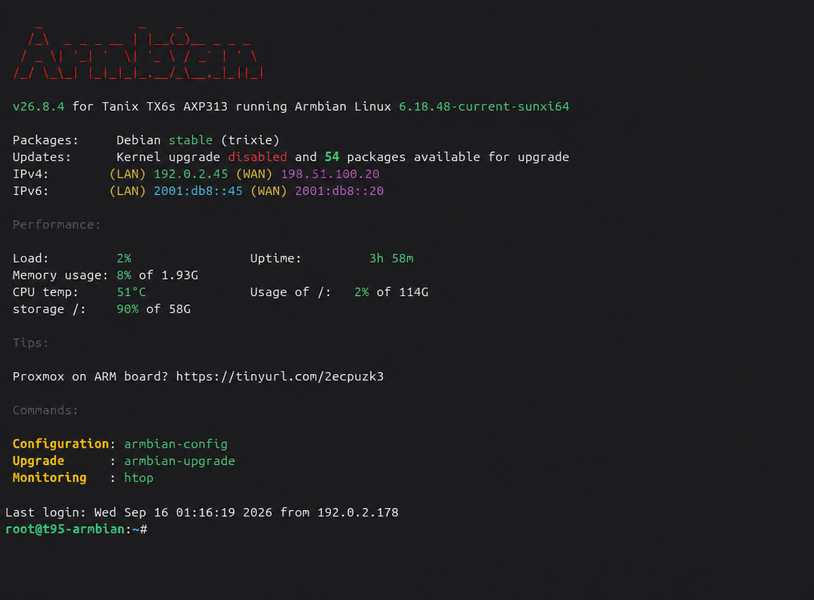

# Technical reference for the tested T95

[Deutsch](TECHNICAL_REFERENCE.md) | **English**

This reference preserves hardware details, measurements, and background from
the former README. For setup, use [installation](INSTALLATION.en.md).
Measurements describe the reference installation; they are not minimum
requirements or guarantees for another device.

## Armbian baseline and T95 changes

The baseline is the official Tanix TX6s/AXP313 Armbian image: Armbian 26.8.4,
Debian 13 Trixie, kernel `6.18.48-current-sunxi64`. Kernel, initramfs, and rootfs
are largely retained. A board-specific boot chain makes the T95 bootable.

| Component | T95 adaptation | Verify for another board |
| --- | --- | --- |
| TOC0/U-Boot | T95 loader at byte 8192, SD loading from `mmc 0:1` | SoC, RAM, PMIC, Boot ROM |
| TF-A/BL31 | Matched to T95 U-Boot | Loader pairing and platform |
| DTB | T95 identity, AC300/RMII, DCDC3 min/max 1.36 V | Actual regulators, PHY, clock, resets |
| Boot environment | T95 DTB, serial console, ext4 root | Kernel paths, UUID, console |
| Ethernet | AC300 pre-initialization | PHY, MDIO, power, reset and clock |
| Image hardening | Locked root, no host keys, keys generated before SSH | Verify on every image rebuild |
| Samba/USB | Separate optional module | Set up after stable Linux/network |

`clk_ignore_unused nohz=off` remain provisional diagnostic/stability settings;
the long-term replacement is still open. Complete file/patch mapping and
source hashes: [change inventory](CHANGES_FROM_ARMBIAN.en.md).

For another board, use [porting](PORTING.en.md). Prepare UART **before**
experiments: 3.3 V TTL, 115200 baud, 8N1, common ground; never 5 V TTL or RS-232.
Early loader/RAM faults cannot be repaired by changing Samba or the rootfs.

## Tested hardware and software

| Area | Reference |
| --- | --- |
| PCB | `H616-T95MAX-AXP313A-V3.0` |
| SoC | Allwinner H616, 4 × Cortex-A53 |
| PMIC / RAM | AXP313A / 2 GiB DRAM |
| Ethernet | Allwinner AC300 EPHY, RMII, `end0`, 100 Mbit/s full duplex |
| System storage | 128 GB microSD, `/dev/mmcblk0`; this is a tested size, not a minimum |
| Internal storage | About 32 GB eMMC, `/dev/mmcblk2`, usable as ext4 data storage |
| Distribution / kernel | Armbian 26.8.4, Debian 13 Trixie / `6.18.48-current-sunxi64` |
| DTB | `sun50i-h616-t95-axp313-tanix-6.18.dtb` |
| Boot layout | microSD, TOC0 at byte 8192, one ext4 partition from byte 4 MiB |

## Documented measurements and tests

| Test | Recorded result |
| --- | --- |
| CPU load | 4 workers for 10 minutes, about 62 °C maximum |
| microSD I/O | About 22–23 MB/s read and 21.5 MB/s write |
| eMMC I/O | About 63.8–77.4 MB/s read; no reliable write measurement |
| Network payload | About 94.5 Mbit/s, or 11–12 MB/s |
| SD boot, clean shutdown, DHCP, SSH, file access | Passed on the exact PCB |
| Samba, USB automount, safe eject/reinsert, VLC over SMB | Passed on the reference installation |
| eMMC Armbian boot | Unsuccessful; SD remains required |
| SSH dashboard | Documented steps tested and confirmed by the project maintainer on 2026-10-17 |
| Bluetooth player | Documented steps tested and confirmed by the project maintainer on 2026-10-17; separate setup |

The base image's DRAM fix was cold-boot verified on two boxes with the exact
PCB revision. The [validation matrix](VALIDATION.en.md) separates these
existing results and confirmed module steps from the remaining individual checks.

## eMMC as an internal data drive

The reference eMMC exposes about 29.1 GiB (nominal 32 GB), plus 4 MiB boot
regions `/dev/mmcblk2boot0` and `/dev/mmcblk2boot1`. Its user region was
prepared separately as:

```text
/dev/mmcblk2p1  ext4  label T95-DATA  mount /srv/T95-DATA
/srv/T95-DATA/Backup  private backup directory, not shared
/srv/T95-DATA/Share   fixed Samba share T95-DATA
```

This is a description of the reference setup, not a formatting command or a
default provided by the SD release. Using eMMC requires a separate original-
data backup, deliberate partitioning/formatting, persistent mounting, and
verification with `findmnt`/`blkid`. Each filesystem has its own UUID.
The [Samba storage guide](../server/samba-usb/README.en.md#which-storage-location-should-i-use)
explains how to select the share path after mounting. Without a mount, a
directory under `/srv/T95-DATA` still belongs to the SD filesystem.

### Performance and wear

Recorded sequential reads: about 77.4 MB/s direct eMMC, 63.8 MB/s with
`hdparm`; microSD about 23.4 MB/s read and 21.5 MB/s write. Thus eMMC reads
were approximately three times faster than that SD card. eMMC write speed
was not measured reliably. Samba throughput is limited by 100 Mbit/s Ethernet.

The eMMC health registers reported:

```text
DEVICE_LIFE_TIME_EST_TYP_A = 0x01
DEVICE_LIFE_TIME_EST_TYP_B = 0x01
PRE_EOL_INFO               = 0x01
```

Lifetime `0x01` indicates the 0–10% used-lifetime estimate; pre-EOL `0x01`
indicates a normal state. These manufacturer estimates are neither a
substitute for backups nor a guarantee of future life.

### Boot strategy

```text
microSD → T95 TOC0/U-Boot and Armbian system
eMMC    → optional separately prepared ext4 data drive
```

The unsuccessful eMMC boot attempt concerned the boot path, not a demonstrated
filesystem-health failure. The public SD route does not overwrite Android
eMMC or make it bootable. Use SD diagnostics for boot faults.

## Example SSH session



This is a real reference-session image with LAN/WAN/IPv6 addresses, hostname,
and login source visibly replaced by documentation values. It is not an
unchanged live capture or a promise of identical dynamic values.

[Release/layout](RELEASE.en.md) · [Validation](VALIDATION.en.md) ·
[UART diagnostics](UART_BRINGUP.en.md) · [Home](../README.en.md)
