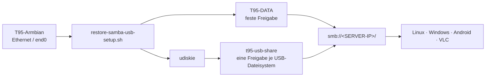

<a id="dateiserver-und-usb-laufwerke-auf-der-t95"></a>

# 📂 Dateiserver und USB-Laufwerke auf der T95

<a id="t95-samba--usb-automount"></a>

**Deutsch** | [English](README.en.md)

Teile Dateien im Heimnetz mit PC, Handy oder VLC. Das Modul verwendet die
regulären Samba-Pakete mit einer **eigenen, auf diese TV-Box und ihre
USB-Anschlüsse abgestimmten Projektkonfiguration** sowie USB-Helfern.
Nach der Einrichtung werden USB-Sticks, SSDs, externe Festplatten und andere
USB-Datenträger mit unterstütztem Dateisystem automatisch eingebunden
(„gemountet“) und als eigene SMB-Netzwerkfreigaben bereitgestellt.
**Manuelles Mounten oder Anlegen einer Freigabe entfällt im Alltag.**

Die feste Freigabe
**`T95-DATA` liegt beim empfohlenen Erststart auf der System-SD** unter
`/srv/t95-sd-data/Share`; sie ist von den USB-Freigaben unabhängig.
Der eingebaute eMMC-Speicher wird nicht formatiert oder eingerichtet.

| Dein Ziel | Hier geht es weiter |
| --- | --- |
| 🚀 Einmalig einrichten | [Voraussetzungen](#voraussetzungen) → [Dateiserver einrichten](#dateiserver-einrichten) |
| 📂 Dateien öffnen und speichern | [PC, Handy und VLC verbinden](#zugriff-von-clients-und-vlc) |
| 🔌 Ein USB-Laufwerk abziehen | [Dieses Laufwerk sicher auswerfen](#usb-sicher-auswerfen) |
| ↩️ Konfiguration zurückholen | [Einrichtung zurücknehmen](#einrichtung-zurücknehmen) |

[Zur Grundinstallation](../../docs/INSTALLATION.md#7-dateiserver-einrichten) · [Alltag](../../docs/DAILY_USE.md) · [Fehlerhilfe](../../docs/TROUBLESHOOTING.md)

> [!TIP]
> **Einmal einrichten, USB-Speicher im Alltag einfach nutzen.** Unterstützte Datenträger werden automatisch gemountet und einzeln freigegeben. Vor dem Abziehen immer [sicher auswerfen](#usb-sicher-auswerfen).

> [!IMPORTANT]
> **Dateisysteme haben unterschiedliche Voraussetzungen.** Mounten hängt von
> Kernel, UDisks und dem Zustand des Mediums ab; bei ext4 gelten zusätzlich die
> gespeicherten Unix-Rechte. Bekannte Auswurf- und Fehlerfälle sind noch offen.
> Der [Samba-/USB-Audit](../../docs/SAMBA_USB_AUDIT.md) beschreibt Grenzen und Korrekturvorschläge.

<a id="voraussetzungen"></a>

## 📋 Voraussetzungen

- T95 läuft von der geprüften SD und du bist als normaler Benutzer per SSH angemeldet.
- [Kernel-/DTB-Sperre](../../docs/INSTALLATION.md#5-kernel-und-dtb-vor-updates-schützen) ist gesetzt.
- Dein T95-Benutzer kann `sudo` verwenden; für die Installation ist Internet nötig.
- USB-Festplatten haben bei Bedarf eine eigene ausreichende Stromversorgung.

Ein [vollständiges SD-Backup](../../docs/BACKUP.md) ist optional.

> [!WARNING]
> Eine vorhandene Samba-Konfiguration wird nach einer Sicherung ersetzt.
> Auf einer bereits angepassten Installation zuerst die
> [technische Referenz](docs/SAMBA-USB-SETUP.md) lesen.

<a id="schnellstart-reproduzierbare-wiederherstellung"></a>

<a id="dateiserver-einrichten"></a>

## 🚀 Dateiserver einrichten

Alle folgenden Installationsbefehle gehören **auf die T95**, nicht auf den PC.
Bleibe im selben SSH-Fenster. Falls Git fehlt, zuerst installieren:

**Auf der T95, normaler SSH-Benutzer; `sudo` wo angegeben:**

```bash
sudo apt update
sudo apt install -y git
```

### 1. Modul beziehen und Manifest prüfen

**Auf der T95, normaler SSH-Benutzer; `sudo` wo angegeben:**

```bash
git clone --branch main --depth 1 \
  https://github.com/Web-Developer-DB/t95-tvbox-to-armbian-home-server.git
cd t95-tvbox-to-armbian-home-server/server/samba-usb
sha256sum -c MANIFEST.sha256
```

**Ergebnis:** Alle Prüfzeilen enden mit `OK`. Bei `FAILED` hier stoppen.
Existiert der Zielordner bereits, die vorhandene Kopie und lokale Änderungen
prüfen, statt sie zu überschreiben. Der Release-Werkzeugeordner auf dem PC ist
kein Checkout der aktuellen Servermodule.

### 2. Linux-Benutzer und Netzwerk prüfen

**Auf der T95, normaler SSH-Benutzer; `sudo` wo angegeben:**

```bash
export T95_USER="$(id -un)"
id "$T95_USER"
ip -brief address
```

**Ergebnis:** `id` zeigt deinen normalen T95-Benutzer, nicht `root`.
Notiere die IPv4-Adresse für den Dateizugriff auf dem PC.

### 3. Installation ausführen

**Auf der T95, normaler SSH-Benutzer; `sudo` wo angegeben:**

```bash
sudo T95_USER="$T95_USER" DATA_PATH=/srv/t95-sd-data/Share \
  ./scripts/restore-samba-usb-setup.sh
```

Die Abfrage von `sudo` erwartet dein Linux-Passwort. Wenn noch kein Samba-Konto
existiert, fragt das Skript anschließend nach einem **Samba-Passwort** für
Dateifreigaben. Dabei erscheinen keine Zeichen. Beide Passwörter haben
unterschiedliche Aufgaben und werden getrennt verwaltet.

**Ergebnis:** Nach `Fertig.` ist die Einrichtung beendet.
Öffne **auf dem Client-PC im Dateimanager** `smb://<SERVER-IP>/T95-DATA`, unter
Windows im Explorer `\\<SERVER-IP>\T95-DATA`. `<SERVER-IP>` durch die Adresse
der Box ersetzen; die Adresse ist kein Terminalbefehl.
Mit T95-Benutzername und Samba-Passwort anmelden. Eine kleine Testdatei
schreiben und wieder öffnen. Dafür ist noch kein USB-Laufwerk nötig.

**Datei lässt sich schreiben und lesen?** Dann weiter mit der Bedienung unten.
Bei Fehlern [Freigaben und Anmeldung prüfen](../../docs/TROUBLESHOOTING.md#freigabe-fehlt-oder-zugriff-wird-abgelehnt).

<a id="zugriff-von-clients-und-vlc"></a>

## 📂 Zugriff von Clients und VLC

Bevorzugt wird die Serverwurzel:

```text
smb://<SERVER-IP>/
```

Direkte Pfade sind ebenfalls möglich:

```text
smb://<SERVER-IP>/T95-DATA
smb://<SERVER-IP>/SunDiskUSB
smb://<SERVER-IP>/Extern-USB-1
```

| Client | Zugriff |
| --- | --- |
| Linux-Dateimanager | `smb://<SERVER-IP>/` öffnen und Samba-Benutzer anmelden |
| Windows-Explorer | `\\<SERVER-IP>\` öffnen |
| Android-Dateimanager | SMB-/Netzwerkfreigabe mit Server-IP und Samba-Konto anlegen |
| VLC | Netzwerkfreigabe öffnen und die gewünschte SMB-Datei auswählen |

Für VLC wird das Samba-Passwort des zuvor festgelegten Benutzers verwendet.
Das Projekt setzt bewusst kein Gastkonto und keine Klartext-Zugangsdaten voraus.

<a id="usb-sicher-auswerfen"></a>

## ⏏️ USB sicher auswerfen

Ein eingestecktes USB-Laufwerk erscheint als eigene Freigabe. Vor dem Abziehen
Dateien auf den Clients schließen und laufende Kopiervorgänge beenden.
Liste zuerst die USB-Freigaben auf:

**Auf der T95, normaler SSH-Benutzer; `sudo` wo angegeben:**

```bash
T95_USER="$(id -un)"
sudo -u "$T95_USER" net usershare list
```

**Beispielantwort — nur lesen:**

```text
SunDiskUSB
```

Ohne eingebundenes USB-Laufwerk darf die Liste leer sein.
`T95-DATA` ist die feste SD-Freigabe und gehört nicht in diese USB-Liste.
Wenn dein Laufwerk gelistet ist, diese Abfrage starten:

**Auf der T95, normaler SSH-Benutzer; `sudo` wo angegeben:**

```bash
read -r -p 'Freigabename des auszuwerfenden USB-Laufwerks: ' T95_SHARE
```

Den tatsächlichen Namen aus deiner Liste eingeben, Enter drücken, dann
**genau dieses Laufwerk** auswerfen:

**Auf der T95, normaler SSH-Benutzer; `sudo` wo angegeben:**

```bash
sudo usb-eject "$T95_SHARE"
```

**Ergebnis:** Erst bei `USB-Datenträger kann entfernt werden.` oder
`Der Datenträger kann entfernt werden.` abziehen. Die zweite Meldung kann
bei einem nicht unterstützten USB-Power-off erscheinen. Bei `DeviceBusy`
geöffnete Dateien und Wiedergaben schließen; ein Terminal darf ebenfalls
nicht im USB-Ordner stehen. Danach erneut versuchen. Weitere
[USB-Fehlerhilfe](../../docs/TROUBLESHOOTING.md#usb-laufwerk-fehlt-oder-ist-belegt).

Danach kontrollieren:

**Auf der T95, normaler SSH-Benutzer; `sudo` wo angegeben:**

```bash
sudo -u "$T95_USER" net usershare list
lsblk -o NAME,SIZE,FSTYPE,LABEL,MOUNTPOINTS
```

Die Freigabe ist verschwunden; nach erfolgreichem Power-off sollte das Gerät
auch nicht mehr in `lsblk` erscheinen. Wiedereinstecken erzeugt die Freigabe erneut.

<details>
<summary>Was beim Auswerfen passiert</summary>

`usb-eject` hält udiskie vorübergehend an, schließt Verbindungen zur gewählten
Freigabe, synchronisiert Schreibvorgänge, hängt alle Partitionen dieses
USB-Geräts aus und schaltet es ab. Zuordnungen werden erst nach erfolgreichem
Aushängen entfernt; anschließend startet udiskie wieder.

</details>

<a id="einrichtung-zurücknehmen"></a>

## ↩️ Einrichtung zurücknehmen

Eine frühere Samba-Konfiguration kann aus der Sicherung wiederhergestellt
werden. Ein vollständiges Deinstallationsprogramm für alle Pakete und
Benutzerdateien ist nicht Teil dieses Moduls. Die Schritte stehen unten in
„Technische Details und Wiederherstellung“.

<details>
<summary>Technische Details und Wiederherstellung</summary>

Alle folgenden Shell-Befehle laufen auf der T95 als normaler SSH-Benutzer;
`sudo` ist dort angegeben, wo es benötigt wird. Anpassungsbeispiele ersetzen
den empfohlenen Installationsaufruf und sind keine zusätzlichen Pflichtschritte.

<a id="ergebnis-auf-einen-blick"></a>

## 📊 Ergebnis auf einen Blick



Die geprüfte Bedienung ist die Serverwurzel `smb://<SERVER-IP>/`. Dort werden
die feste Freigabe `T95-DATA` und alle aktuell eingesteckten USB-/SSD-
Freigaben gemeinsam angezeigt.

Es gibt absichtlich **keine** statische `[USB]`-Sammelfreigabe. Jedes Medium
zeigt dadurch seine echte Kapazität und den korrekten freien Speicherplatz.

<a id="was-richtet-das-samba-modul-ein"></a>

## ⚙️ Was richtet das Samba-Modul ein?

Das Modul macht aus der laufenden T95 einen zugriffsgeschützten Dateiserver:

- `T95-DATA` ist eine feste Freigabe für den gewählten Speicherordner.
- USB-Sticks und USB-Festplatten werden automatisch eingebunden.
- Für jedes eingehängte USB-Dateisystem erscheint eine eigene Freigabe.
- Linux, Windows, Android und VLC greifen mit demselben Linux-/Samba-Konto zu.
- `usb-eject` wirft ein USB-Laufwerk kontrolliert aus, bevor es abgezogen wird.

Die festen Daten von `T95-DATA` und die dynamischen USB-Freigaben sind zwei
getrennte Dinge. Der Speicherpfad für `T95-DATA` wird bei der Einrichtung mit
`DATA_PATH` gewählt. USB-Laufwerke werden dagegen automatisch eingebunden und
brauchen keine manuelle Pfadänderung.

### Welchen Speicherort soll ich wählen?

| Ort | Beispiel für `DATA_PATH` | Wann passend? |
| --- | --- | --- |
| System-microSD | `/srv/t95-sd-data/Share` | Für kleine Datenmengen und einen einfachen Start. Viel Schreiben kann die SD-Karte stärker beanspruchen. |
| Interne eMMC | `/srv/T95-DATA/Share` | Empfohlen für regelmäßige oder größere Datenmengen, wenn die eMMC bereits dauerhaft an `/srv/T95-DATA` eingehängt ist. |
| USB-Laufwerk | Kein `DATA_PATH` nötig | USB-Speicher wird als eigene dynamische Freigabe automatisch hinzugefügt. |

Das Standardziel `/srv/T95-DATA/Share` setzt voraus, dass ein eMMC-Dateisystem
unter `/srv/T95-DATA` eingehängt ist. Ohne diesen Mount liegt der Ordner
stattdessen auf dem System-Dateisystem der SD-Karte. Soll die feste Freigabe
bewusst auf der SD-Karte liegen, wähle einen eigenen Ordner wie
`/srv/t95-sd-data/Share`. Wenn der eMMC-Pfad verwendet werden soll, muss die
eMMC zuerst eingerichtet, dauerhaft eingehängt und mit `findmnt` geprüft
werden. Das Samba-Skript formatiert, partitioniert oder verschiebt keine
vorhandenen Dateien.

### Getestete Referenzplattform

| Bereich | Referenz |
| --- | --- |
| Hardware | T95 `H616-T95MAX-AXP313A-V3.0` mit Allwinner AC300 Ethernet |
| System | Armbian 26.8.4, Debian 13 Trixie, Kernel 6.18 |
| Netzwerk | Ethernet über `end0`, DHCP, SMB2/SMB3 |
| Automount | UDisks2 + udiskie + dynamische Samba-Usershares |
| Abnahme | `T95-DATA`, USB-Automount, sicherer Auswurf, Wiedereinstecken und VLC über SMB |

Andere Debian-/Armbian-Systeme können funktionieren, sind aber durch diese
Projektabnahme nicht automatisch bestätigt.

### Einrichtung anpassen

Die folgenden Alternativen ersetzen den Aufruf aus Schritt 3. Führe sie nur
aus, wenn du bewusst einen anderen Speicherort oder Namen wählen möchtest.

Du kannst Benutzername, Servername und festen Speicherpfad beim Skriptaufruf
setzen. Ersetze `serveruser` durch deinen normalen Linux-Benutzer. `DATA_PATH`
legt fest, wohin die feste Freigabe `T95-DATA` zeigt:

**Auf der T95, normaler SSH-Benutzer; `sudo` wo angegeben:**

```bash
sudo T95_USER=serveruser \
  NETBIOS_NAME=T95-SERVER \
  DATA_PATH=/srv/t95-sd-data/Share \
  ./scripts/restore-samba-usb-setup.sh
```

| Variable | Pflicht | Standard | Bedeutung |
| --- | :---: | --- | --- |
| `T95_USER` | **ja** | – | vorhandener Linux- und Samba-Benutzer |
| `NETBIOS_NAME` | nein | `T95-SERVER` | Name des Servers im SMB-Netz |
| `DATA_PATH` | nein | `/srv/T95-DATA/Share` | Verzeichnis der festen Freigabe |

Für den empfohlenen SD-Pfad gilt der Aufruf unter [Dateiserver einrichten](#dateiserver-einrichten).

Beispiel: feste Freigabe auf eMMC einrichten, die bereits unter
`/srv/T95-DATA` eingehängt ist:

**Auf der T95, normaler SSH-Benutzer; `sudo` wo angegeben:**

```bash
findmnt /srv/T95-DATA
```

Nur fortfahren, wenn der erwartete eMMC-Mount angezeigt wird. Danach ausführen:

**Auf der T95, normaler SSH-Benutzer; `sudo` wo angegeben:**

```bash
sudo T95_USER=serveruser \
  DATA_PATH=/srv/T95-DATA/Share \
  ./scripts/restore-samba-usb-setup.sh
```

Führe den eMMC-Aufruf erst aus, wenn `findmnt` den erwarteten eMMC-Mount zeigt.
Sonst würde der Ordner auf dem gerade darunterliegenden Dateisystem, meist der
System-SD, erstellt.

Das Skript verwendet außerdem `/media/<T95_USER>` als USB-Mountbasis und
`~/.local/state/t95-usb-shares` für dynamische USB-Zuordnungen.

### Einstellungen später ändern

Wechsle in das geklonte Modulverzeichnis und rufe das Restore-Skript mit den
gewünschten Werten erneut auf. Zum Beispiel, um `T95-DATA` von eMMC auf die
SD-Karte zu verlegen:

**Auf der T95, normaler SSH-Benutzer; `sudo` wo angegeben:**

```bash
cd ~/t95-tvbox-to-armbian-home-server/server/samba-usb
sudo T95_USER=serveruser \
  DATA_PATH=/srv/t95-sd-data/Share \
  ./scripts/restore-samba-usb-setup.sh
```

Das Skript sichert `/etc/samba/smb.conf` mit Zeitstempel und erzeugt sie neu.
Es verschiebt deine Dateien **nicht** vom alten Speicherort zum neuen. Kopiere
oder verschiebe Daten daher selbst und prüfe den neuen Pfad, bevor du alte
Dateien löschst. Eigene direkte Änderungen an `/etc/samba/smb.conf` werden bei
einem erneuten Aufruf durch die Projektkonfiguration ersetzt; Sicherungen
liegen unter `/etc/samba/smb.conf.before-t95.*`.

### Die mitgelieferten Skripte

| Skript | Was es macht | Muss ich es selbst starten? |
| --- | --- | --- |
| `scripts/restore-samba-usb-setup.sh` | Installiert Pakete und Dienste, erstellt `T95-DATA` und konfiguriert Samba sowie USB-Automount. | Ja, einmal bei der Einrichtung; erneut nur zum Ändern der Konfiguration. |
| `scripts/t95-usb-share` | Erstellt oder entfernt die dynamische Freigabe für ein eingebundenes USB-Dateisystem. | Nein, `udiskie` ruft es automatisch auf. |
| `scripts/usb-eject` | Trennt die ausgewählte Freigabe, synchronisiert Schreibvorgänge, hängt das Laufwerk aus und schaltet es ab. | Ja, vor dem physischen Abziehen eines USB-Laufwerks. |

Unter [USB sicher auswerfen](#usb-sicher-auswerfen) wählst du das tatsächliche Laufwerk aus.

<a id="nach-der-installation-prüfen"></a>

## ✅ Nach der Installation prüfen

Alle Prüfungen laufen auf der T95, außer dem abschließenden Clienttest.

**Auf der T95, normaler SSH-Benutzer; `sudo` wo angegeben:**

```bash
T95_USER="$(id -un)"
sudo testparm -s
systemctl --no-pager --full status smbd
systemctl --no-pager --full status nmbd
sudo -u "$T95_USER" net usershare list
T95_UID="$(id -u "$T95_USER")"
sudo -u "$T95_USER" XDG_RUNTIME_DIR="/run/user/$T95_UID" \
  systemctl --user --no-pager --full status udiskie.service
```

Erwartet werden:

- `testparm` meldet eine gültige Konfiguration ohne Syntaxfehler.
- `smbd` und – sofern auf der Distribution vorhanden – `nmbd` laufen.
- `udiskie.service` ist für `T95_USER` aktiv.
- `testparm -s` zeigt den Abschnitt `[T95-DATA]` mit dem gewählten Pfad.
- `net usershare list` zeigt nur dynamische USB-Freigaben. Ohne eingebundenes
  USB-Laufwerk darf die Ausgabe leer sein; `T95-DATA` gehört nicht in diese Liste.

Öffne auf dem Client `smb://<SERVER-IP>/T95-DATA`, lege eine kleine Testdatei
an und lies sie wieder. Erst dieser Test bestätigt den tatsächlichen Zugriff.

### USB-Datenträger anschließen

Nach dem Einstecken:

**Auf der T95, normaler SSH-Benutzer; `sudo` wo angegeben:**

```bash
lsblk -o NAME,SIZE,FSTYPE,LABEL,MOUNTPOINTS
sudo -u "$T95_USER" net usershare list
journalctl -t T95-USB-SHARE --no-pager -n 30
```

Ein gelabeltes Medium erhält einen bereinigten Namen aus seinem Label, zum
Beispiel `SunDiskUSB`. Ein Medium ohne Label erhält `Extern-USB-1`, danach
`Extern-USB-2` usw. Ein bereits veröffentlichter Mountpunkt erzeugt keine
doppelte Freigabe.

<a id="konfiguration-wiederherstellen"></a>

## ↩️ Konfiguration wiederherstellen

Vor dem Überschreiben legt das Restore-Skript eine Sicherung an:

```text
/etc/samba/smb.conf.before-t95.<YYYYMMDD-HHMMSS>
```

Verfügbare Sicherungen anzeigen und die gewünschte Sicherung kontrolliert
wiederherstellen:

**Auf der T95, normaler SSH-Benutzer; `sudo` wo angegeben:**

```bash
sudo ls -1t /etc/samba/smb.conf.before-t95.*
sudo cp -a "/etc/samba/smb.conf.before-t95.<TIMESTAMP>" /etc/samba/smb.conf
sudo testparm -s
sudo systemctl restart smbd
```

Dies stellt die Samba-Konfigurationsdatei wieder her. Ein vollständiges
Deinstallations- oder Rückbauprogramm für alle installierten Pakete, Polkit-
Regeln und Benutzerdateien ist absichtlich nicht Bestandteil dieses Moduls.

<a id="sicherheit-und-veröffentlichung"></a>

## 🔒 Sicherheit und Veröffentlichung

> [!CAUTION]
> Niemals produktive Geheimnisse in dieses Repository kopieren.

Nicht veröffentlichen:

- `/var/lib/samba/private/passdb.tdb`;
- Samba-Passwörter oder Klartext-Zugangsdaten;
- `/etc/shadow`, SSH-Private-Keys und komplette Systembackups;
- lokale Images, UART-Captures oder persönliche Konfigurationsdateien.

Die Vorlagen und Skripte im Modul enthalten keine Samba-Passwörter. Das
Passwort wird erst auf der T95 mit `smbpasswd` gesetzt.

<a id="weiterführende-dokumentation"></a>

## 📚 Weiterführende Dokumentation

- [Vollständige technische Dokumentation](docs/SAMBA-USB-SETUP.md)
- [Restore-Checkliste](docs/RESTORE-CHECKLIST.md)
- [Fehlerdiagnose](docs/TROUBLESHOOTING.md)
- [Hinweise zur GitHub-Veröffentlichung](docs/GITHUB-PUBLISH.md)
- [Änderungsverlauf](CHANGELOG.md)

</details>
